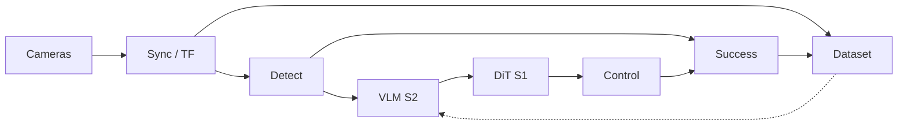

# JOSH computer vision

This folder is the Computer Vision team's home in JOSH Software.

You do not need to invent a robot brain that classifies the world and then separately learns every task. You need a trustworthy stream of **time-aligned images, robot state, language goals, and success labels** so a VLA and RL stack can act — and so you can prove whether they did.

This is a map of ideas and contracts. The tldraw architecture diagram comes after this map is stable.

## Where developers work

Developers build in one of these folders. This file and `docs/` stay the map.

| Team | Folder | This semester |
| --- | --- | --- |
| Vision Training | [vision-training](vision-training/README.md) | Pretrained YOLO26n, then our weights, then detections to RL at 10 Hz until the software lead confirms a different number |
| Vector Navigation | [vector-navigation](vector-navigation/README.md) | MATLAB monocular SLAM: a map and a pose. A walking direction comes from a planner on that map, later |

Practice sketches live in [`simple/`](simple/). The current meeting is Vision Training step 1. Vector Navigation is specified so it can start when people move over.

## Timeline

| When | CV focus |
| --- | --- |
| Fall 2026 | Perception + data first |
| Winter 2026 | VLA in sim + rewards |
| 2027–28 | Full vision on hardware |

## Three layers

Developers own a box. The CV lead owns the contracts between boxes.

| Layer | Name | What it is |
| --- | --- | --- |
| A | [Perception runtime](docs/01-computer-vision.md) | Cameras, calibration, sync, detectors, trackers, 3D estimates, visualization. Runs every cycle on the robot or in Isaac Sim. Must fail loudly. |
| B | [Data pipeline](docs/02-data-pipeline.md) | Record, version, annotate, convert to LeRobot/GR00T, replay. **This is the actual product this school year.** No pipeline, no VLA, no learning. |
| C | [Policy consumers](docs/03-vla-groot.md) | GR00T inference, RL training in Isaac Lab, task graph, success detectors. They eat Layers A and B. They are not a replacement for them. |

## Four technologies that are not the same thing

Detection, VLAs, and RL cooperate. They are different products with different owners, failure modes, and data.

| Name | Input | Output | Who uses it on JOSH |
| --- | --- | --- | --- |
| Object detection / tracking | Pixels | Boxes, classes, track ids, maybe 3D pose | Debug, navigation targets, grasp checks, rewards |
| Vision-language model (VLM) | Pixels + text | Text, embeddings, subgoals, "what is this?" | Inside GR00T System 2; optional open-vocab queries |
| Vision-language-action (VLA) | Pixels + text + joint state | Action chunks (future joint targets) | Manipulation / whole-body skills after fine-tune |
| Reinforcement learning | Observations + reward | A policy that maximizes return | Locomotion, recovery, improving a fine-tuned skill |

ROS 2 does not "run on GR00T." ROS 2 is the robot's nervous system. GR00T is a neural policy (a server you query). Python is how you train and how a ROS node packs observations and unpacks actions. Isaac Sim / Isaac Lab is the gym.

## Closed loop at inference time

Solid arrows are the live robot. The dashed edge is how episodes become training data.

## Wrong goal vs useful goal

| Avoid this framing | Use this instead |
| --- | --- |
| A flawless pipeline that works a majority of the time on any task | An observable pipeline with versioned data, known failure modes, and a success detector per skill |
| One VLA that "understands the world" and does basketball end-to-end on day one | A task graph of skills. VLA for short-horizon manipulation. RL for walking. CV for find / verify |
| Train GR00T from scratch on student GPUs | Fine-tune `nvidia/GR00T-N1.7` on a JOSH embodiment with a few dozen clean demos per skill |
| CV team waits for a finished humanoid | Sim cameras + a tabletop / camera rig this fall. Hardware is a later consumer of the same schema |

## Motors are not CV's job. The action contract is.

Electrical and mechanical calibrate actuators. CV still must freeze, with the software / RL lead, the **action vector**: joint order, units, relative vs absolute, chunk length, control rate. If that contract drifts, every dataset is junk.

## Docs

| Doc | What it covers |
| --- | --- |
| [Vision Training](vision-training/README.md) | YOLO steps. Current assignment is step 1 |
| [Vector Navigation](vector-navigation/README.md) | MATLAB SLAM steps, then a heading for RL |
| [Computer vision](docs/01-computer-vision.md) | Geometry, detectors, tracking, 3D, success detectors |
| [Data pipeline](docs/02-data-pipeline.md) | Episodes, LeRobot, capture vs train, validators |
| [VLAs / GR00T](docs/03-vla-groot.md) | Dual-system VLA, N1.7 I/O, how we fine-tune |
| [RL handshake](docs/04-rl-handshake.md) | MDP interface, rewards, three RL jobs |
| [ROS 2 + Isaac](docs/05-ros2-isaac.md) | Nodes, NVIDIA stack, frequencies, budget |
| [Basketball task](docs/06-basketball-task.md) | Worked long-horizon example and skill contracts |
| [Work packages](docs/07-work-packages.md) | What 1–2 developers can own |
| [Study path](docs/08-study-path.md) | What to learn, in order |

Scratch experiments are listed in [`simple/README.md`](simple/README.md).
