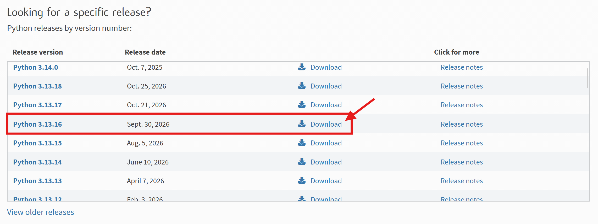
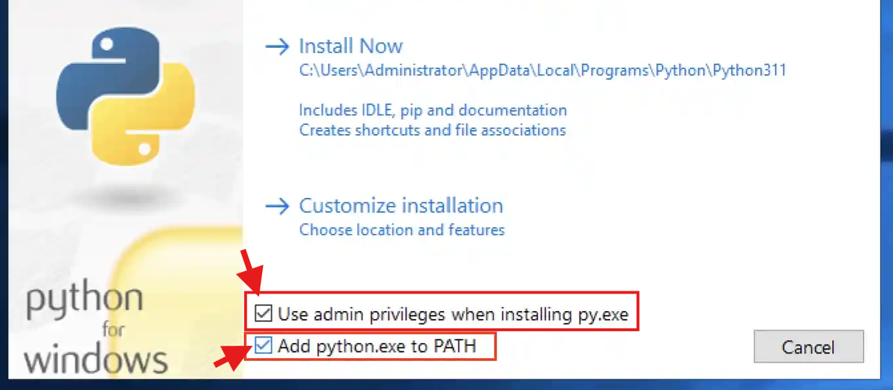
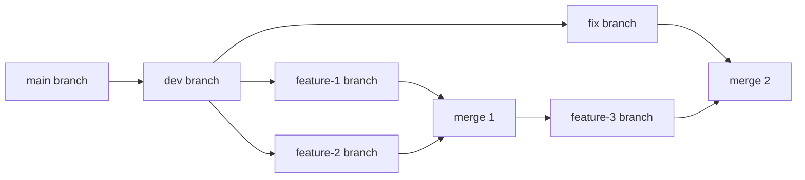

# Set Up

These should be the steps to run to reach the current state before Monday's Stand Up:

## 1. Install Git

**If you already have `git` then SKIP ts!**

This section was written by chat 😃 cause I wanna go to bed.

First check if **git** is installed.

```bash
git --version
```

If there are no errors, go to [Step 2](#2-get-the-repository-repo).

If git is NOT found then you need to download it:

1. Go to [Git's download page](https://git-scm.com/download/win) and download the Windows installer (64-bit).

2. Open the `.exe` file. When the installer asks how to adjust your PATH, choose **Git from the command line and also from 3rd-party software**. Leave the rest of the options as they are and finish the install.

3. To confirm that it has downloaded, `RESTART` your terminal (Windows Powershell, Command Prompt, etc.) by closing it and opening a new one.

4. Then run the version command again:

```bash
git --version
```

If there are NO errors, good 😃

If there ARE errors, then ask chat 😃


## 2. Get the Repository (Repo)

Go to a folder on your pc (using the terminal $\to$ `cd [folder_name]` to move into the folder you want)

Then run:

```bash
git clone https://github.com/WEBotsUWO/JOSH-Software.git
```

Then **MAKE SURE TO MOVE INTO THE CLONED REPO** $\to$ run `cd JOSH-Software`

Also, **MAKE SURE TO MOVE INTO THE COMPUTER VISION FOLDER** $\to$ run `cd './Computer Vision'`

Now, I am assuming that most people are using VSCode (and already have it installed) so if you do, then run:

```bash
code ./ # or just code .
```

If this doesn't work then ask— just open VSCode and click `Open Folder` and find the JOSH-Software folder, then the Computer Vision sub folder and open it.

## 3. Install Python

First check if **python** is installed.

```bash
python --version
```

If there are no errors, then make sure that your python version is from `3.12` to `3.14` and go to [Step 4](#4-create-virtual-environment).

If python is NOT found then you need to download it:

1. Go to [Python's Download page](https://www.python.org/downloads/) and download `Python 3.13.16` or any version from `3.12` to `3.14`.



2. Open the `.exe` file and **MAKE SURE TO CHECK BOTH BOXES!!!**



3. Then click on `Install Now` and then the `Yes` button on the Windows prompt.

4. To confirm that it has downloaded, you need to `RESTART` your terminal (Windows Powershell, Command Prompt, etc.) by closing it and opening a new one.

5. Then run the version command again:

```bash
python --version
```

If there are NO errors, good 😃

If there ARE errors, then ngl, just ask chat 😃

## 4. Create Virtual Environment

If you're using `Windows Powershell`, then I feel bad for you (I use it too 😭 and I understand your pain $\to$ shameless plug, but check out my project that allows you to run Linux/Unix commands on powershell: [linux-commands-for-powershell](https://github.com/davidanukam/linux-commands-for-powershell))

Unfortunately, we need to do this weird thing that I don't want to explain so just run it and give me access to your pc:

```bash
Set-ExecutionPolicy -ExecutionPolicy RemoteSigned -Scope CurrentUser
```

Now that I have access... (I'm so funny)

Just ignore me.

(ps. I don't get access to anything, obviously. I'm only adding this for PR reasons. Sam, don't fire me pls.)

---

Anyway, we want to make sure our files have the same dependencies (and versions) so we each need to create a **virtual environment**.

Run this command:

```bash
python -m venv .venv
```

Hopefully this worked. Check VSCode and you should see a folder called `.venv`

We now want to *activate* this virtual environment (oooh fancy, ik).

1. **YOU WILL NEED TO ACTIVATE THIS VENV BEFORE RUNNING ANY FILES SO MAKE SURE TO REFER TO THIS COMMAND IF YOU FORGET!!!**

In Windows Powershell:

```bash
./.venv/Scripts/Activate.ps1
```

OR, in Command Prompt:

```bash
.venv/Scripts/activate
```

In your terminal, you should now be able to see `(.venv)` somewhere in the shell prompt.

2. **AFTER YOUR WORK SESSION, MAKE SURE TO *DEACTIVATE* THE VENV**

In Windows Powershell and Command Prompt:

```bash
deactivate
```

In your terminal, you should NO LONGER see `(.venv)` somewhere in the shell prompt.

## 5. Install Requirements (Dependencies)

It's nice to have `pip` upgraded to the current release so before you continue, run:

```bash
python.exe -m pip install --upgrade pip
```

**"What is pip?"** you ask....

Anyway, there should be a [`requirements.txt`](../requirements.txt) file in the Explorer sidebar in VSCode.

We want to install all of the dependencies listed in it so:

**MAKE SURE YOU SEE (.venv) OR .venv SOMEWHERE IN THE SHELL PROMPT IN YOUR TERMINAL $\underline{BEFORE}$ RUNNING**:

```bash
pip install -r requirements.txt
```

Prepare yourself, the next section is a doozy 🥲

## 6. Create Your Own Branch

Okay so now that the rough part is kinda over (you have no idea), every further change will affect the `cv` branch (which is the main branch where all of our work will be merged into BEFORE asking to merge everything into the `main` branch).

If that didn't make sense, don't worry, it will soon........... but ngl, just ask chat 😃

---

Regardless, it's time to create our own branches.

Quick background knowledge $\to$ trees have branches.

Wow. Cool.

So we need to think like trees and leave! (get it? Cause leave is like leaf and leaves spawn on tr—)

But if you think about how branches work (or grow, or something, idk), you can see that where the branch starts to ... ig *branch out* from, is important.

If I have made a bunch of changes to a certain branch and I want to make a new one to do other stuff, then the branch that I am on before *branching out* will have the content that I inherit or start with.

The best way to learn is with an example (LET ME GO TO BED!!!):



So when we make the `dev branch` first, it starts with the same content that is in `main branch` but we make some changes and **commit** it to its own branch.

So when we create the `feature-1 branch` and the `feature-2 branch`, they both start with the same exact content that was in the `dev branch` the moment we created them. Again, we can update things in either of them.

Then we **merge** both of those branches together to create `merge 1` as both of their contents have to be inspected so that we can select parts of each to keep (and deal with any conflicts, hence the term **merge conflicts!**)

From there we create the `feature-3 branch` which starts with the same content that `merge 1` has at the moment of creation.

Now, let's say I wanted to fix something earlier (or someone else was still working) in the `dev branch`, then we can *checkout* the `dev branch` (so just move back to it with the HEAD pointer, yada yada yada NERD!) and make a new branch called `fix branch`.

The `fix branch`, will start with everything in the `dev branch` but notice that we have newer branches down the line (the `merge 1`, and `feature-3 branch`). Any of the changes in the newer branches WILL NOT be in this `fix branch` that we have just made.

Nevertheless, we have made some fixes and we now want to merge back into our main line or stream or path or whatever.

IMPORTANT $\to$ We would need to move BACK to the `feature-3 branch` before merging the `fix branch` into it to create `merge 2`.

(Ask me if you need any help understanding these concepts better. Otherwise ..... ask chat 😃)

---

Anyway, let's make a new branch! Yay! I'm tired (LET ME SLEEP!)

First, we need to start off in the `cv` branch so let's check which branch you are in/on:

```bash
git branch
```

You should see 1 or more branch names show up in your terminal. The one with a `*` in front is the branch you are in/on.

If you do NOT see `cv` in that list, run:

```bash
git fetch --all
```

Then, if the `*` is not already in front of `cv`, run:

```bash
git checkout cv
```

Now when you run:

```bash
git branch
```

You should now see the `*` in front of the `cv` branch!

Please tell me this worked 😭🙏 (ONBOARDING HURTS THE SOUL)

---

Okay, finally! Stand up a few times and hit a couple jumping jacks to congratulate yourself on making it this far.

I know I would have quit when I read Set Up.

Anyway, since everyone here is working on *cv*, the naming convention for branches will be `[your_name]-cv`.

For example, mine would be: `david-cv`

So you should run:

```bash
git checkout -b [your_name]-cv # without the brackets of course
```

Now check if it worked by running:


```bash
git branch
```

If you see the `*` in front of your newly made branch then YAY!

If you don't, then gg's. Don't ask me, just ask chat 😃

(wait... do I hear my bed calling me?)

Lastly, you need to push your branch (which is called your `local branch`) to the Repository (Repo) so that it publishes your *local* changes to the `remote branch`.

(Usually local branch looks like `david-cv` (for example) and remote branch looks like `origin/david-cv` or `origin david-cv` (for example) but honestly we don't care rn)

To push your new branch to its *remote* copy, run:

```bash
git push -u origin [your_name]-cv # without the brackets of course 2
```

(The `-u` is to set an **Upstream**, which just allows you to run `git push` instead of `git push origin [your_name]-cv` every time)

---

## 7. Common Everyday Loop

So from now on:

1. Run `git pull origin cv` first so the latest `cv` commits land in your branch. (You might get some *merge conflicts* but honestly just chat it or try to figure it out, or hit me up)
2. Make some changes in your branch (do some coding)
3. Run `git status` to check your branch (Hopefully, you see `red` file/folder names)
4. Run `git add .` to add the new/modified/deleted files/folders to the *staging area* (dw about it, or ask big gtt 😃)
5. Run `git commit -m "[commit message]"`
    - example: `git commit -m "Updated README file"`

Another example for the `commit` command:
```bash
git commit -m "Fixed importing bug
- Added new linter
- Uploaded cached images"
```

6. Now rerun `git status`. A finished commit does not leave a list of red files. If you still see red, those files were not added, so ask the w's in the shat 😃
7. Finally, run `git push` and pray nothing breaks (no actually pray the `cv` branch doesn't get nuked later on or we're cooked. Maybe even fried. So please make sure you are in `your branch` before making any changes and especially BEFORE running `git push`. Thanks!)

## 8. Done for now ig, idk, kinda, just @ me on discord

GN! 🥱 (or GM 🌞 iykyk)

(I should probably remove the silliness later but for now, you gotta deal with it)

Thanks for making it through!!! YOU GOT THIS 👍
