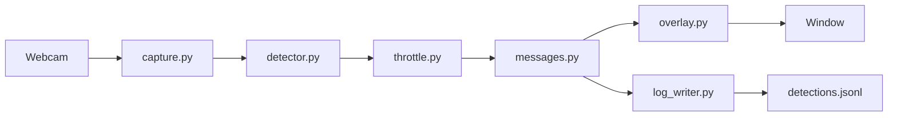

# Vision Training structure

[Back to the team list](../README.md)

Step 1 is one process on a laptop. Later steps add a filter, a tracker, and a ROS 2 node around the same record.



`run_step1.py` calls that chain. It does not reimplement any box.

## Modules

| Module | Owns |
| --- | --- |
| `capture.py` | Camera open, BGR frame, grab time |
| `detector.py` | `yolo26n.pt` loaded once. One frame in, boxes out. Every class |
| `throttle.py` | Emit gate at 10 Hz, skip count |
| `messages.py` | The detection record and its JSON |
| `overlay.py` | Boxes, class, confidence, camera FPS, emit Hz. Returns an image |
| `log_writer.py` | One JSON object per emitted frame, appended to `detections.jsonl` |
| `run_step1.py` | The loop, the window, quit on `q` |

## Detection record

Draft for step 1. Step 2 freezes it for ROS 2. Pixel origin is the top-left of the image. `x` increases right, `y` increases down.

| Field | Type | Meaning |
| --- | --- | --- |
| `frame_time` | float, seconds | `time.perf_counter()` when the frame was grabbed |
| `emit_time` | float, seconds | `time.perf_counter()` when the gate let this record out |
| `detections` | list | Boxes in this emitted frame. Empty is valid |
| `class_id` | int | Checkpoint class index |
| `class_name` | str | From the checkpoint's own names. The detector looks this up |
| `confidence` | float | Detector score, 0 to 1 |
| `xyxy` | four floats | Left, top, right, bottom, in pixels |

JSON shape:

```json
{
  "frame_time": 0.0,
  "emit_time": 0.0,
  "detections": [
    {
      "class_id": 0,
      "class_name": "person",
      "confidence": 0.9,
      "xyxy": [0.0, 0.0, 10.0, 10.0]
    }
  ]
}
```

## Rates

The camera runs at whatever the laptop delivers. The gate emits at 10 Hz. The overlay shows both numbers so a fast camera and a slow publish are visible at the same time.

Step 7 wraps this record in `vision_msgs/Detection2DArray` (or the message the software lead picks) and adds a debug image topic. The fields stay the ones in the table.
